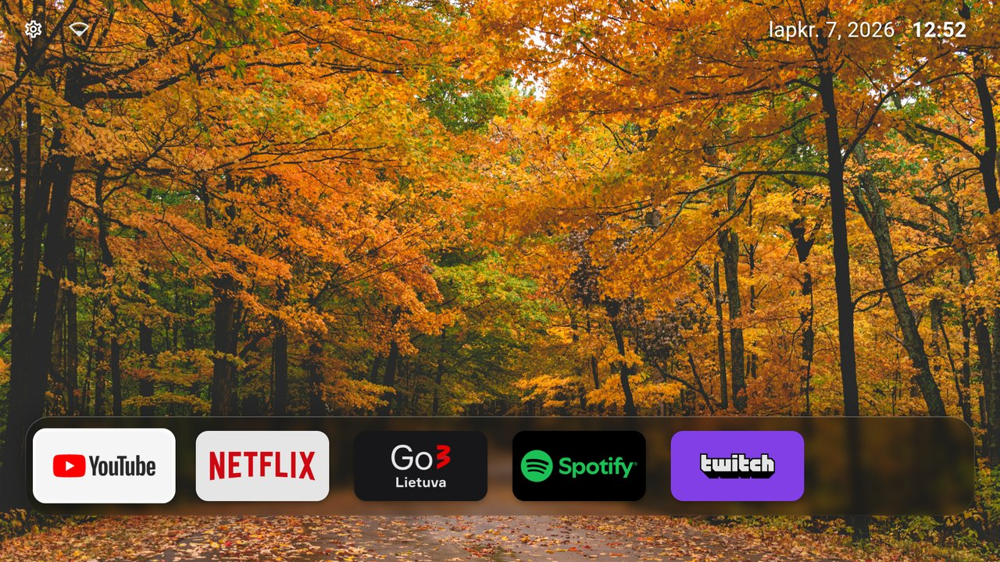
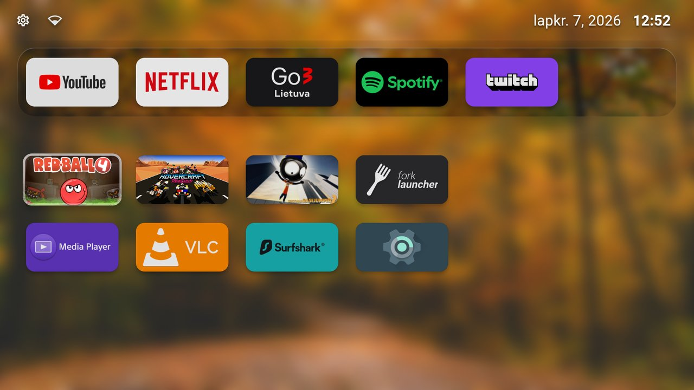
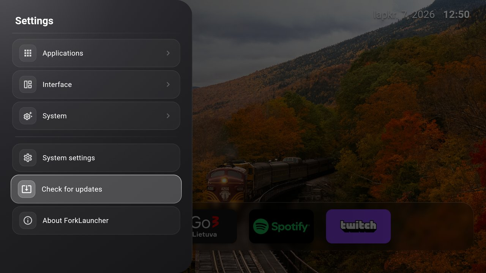
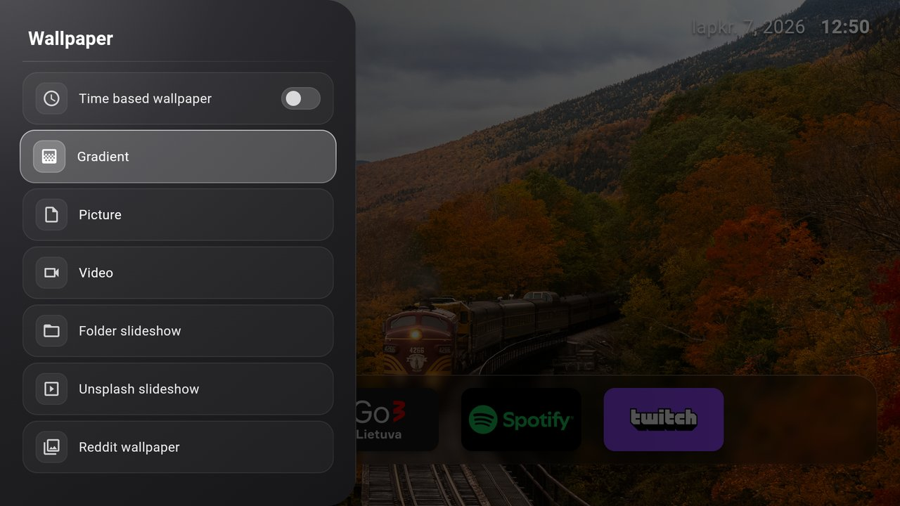
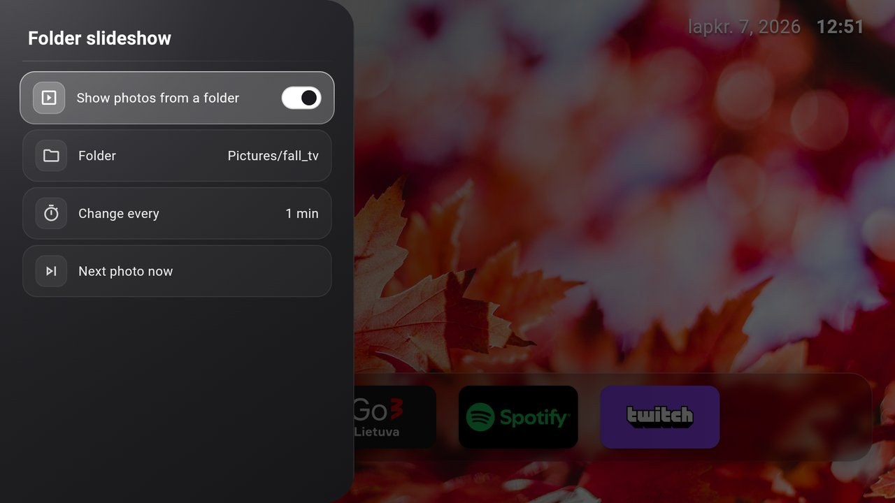

# ForkLauncher

**ForkLauncher** is a personal open-source launcher for Android TV, built as a fork of
[Arc Launcher](https://github.com/meddouribadis/arclauncher) by [meddouribadis](https://github.com/meddouribadis).
All credit for the launcher itself goes to Arc Launcher and the projects it is based on.

## What this fork adds

- **Folder slideshow** - Random wallpaper from a folder on the TV, changed on a timer you choose, with no internet needed (Interface > Wallpaper > Folder slideshow).
- **Wallpaper-only view** - Press Home while already on the home screen to hide the status bar and every section. Any other key brings them back without opening an app.
- **Clean home screen** - Sections stay below the screen edge until you press Down from the dock.
- **Remote buttons** - Choose which app a remote button opens, or make it do nothing (System > Remote buttons). Needs the "ForkLauncher remote buttons" accessibility service turned on. Buttons the TV handles itself before any app, such as Disney+ and Prime Video on TCL TVs, can't be changed.

## Installation

Download `forklauncher-<version>-armeabi-v7a.apk` (32-bit TVs) or `-arm64-v8a.apk` from the
[latest release](https://github.com/w4zZz4p/ForkLauncher/releases/latest) and install it, for example over ADB:

```shell
$ adb install -r forklauncher-0.1.0-armeabi-v7a.apk
```

Later versions can be installed from inside the app: Settings > Check for updates.

The package name is `io.github.w4zzz4p.forklauncher`, so it installs alongside the official Arc Launcher and the two never update each other.

### Building from source

```shell
$ flutter build apk --release --flavor github --target-platform android-arm
$ adb install -r build/app/outputs/flutter-apk/app-armeabi-v7a-github-release.apk
```

Release builds are signed through `storeFile`, `storePassword`, `keyAlias` and `keyPassword` in `android/local.properties`, which git ignores. Never commit your keystore or that file.

Local builds leave the in-app updater off. Add `--dart-define=ENABLE_SELF_UPDATER=true` to include it, as the release builds do.

The features below come from Arc Launcher unless listed above.

## Features

### Interface & Navigation
- **Grid Layout** - Clean smart TV app grid with configurable row and column sizing.
- **Watch Next** - Continue watching shows directly from a top-row carousel.
- **Remote Navigation** - High-visibility double-border focus indicators with smooth D-pad navigation.
- **Custom Categories** - Group apps into favorites or custom sections; reorder categories with Left/Right keys.
- **Quick Status Bar** - Displays time, daily data usage, and a shortcut to system Wi-Fi settings.
- **Auto-Hide Status Bar** - Hides the status bar when scrolling into the app grid to maximize screen space.
- **Accent Colors** - Personalize the UI with multiple color presets.
- **Multilingual** - Available in English, Spanish, Turkish, Vietnamese, and Simplified Chinese.

### Wallpapers & Screensavers
- **Video Wallpapers** - Set animated video files (MP4/WebM) as the home screen background.
- **Slideshows** - Rotate wallpapers from custom subreddits or Unsplash categories with configurable intervals.
- **OLED Protection** - Pitch-black theme option and screensaver with position-shifting clock to prevent burn-in.
- **Time-Based Wallpaper** - Automatically switch between day and night wallpapers.

### System & Tools
- **No Ads & No Tracking** - Completely open source with zero sponsored content or ads.
- **In-App Updater** - Check for new releases, read what changed and install them from inside the app.
- **Sideloaded App Support** - Displays and launches non-TV Android apps without extra workarounds.
- **Brightness Scheduler (Experimental)** - Automatically adjust brightness based on time (requires ADB `WRITE_SETTINGS` permission).

> [!NOTE]
> Because Android's `WallpaperManager` is not available on some Android TV devices, ForkLauncher manages its own wallpapers. Pictures and videos are picked from the TV's storage with a built-in picker, so no file explorer is needed.

> [!TIP]
> **Video Wallpaper Performance:** Video wallpapers are loaded into memory for smooth playback. Use compressed clips (ideally under 10MB) on lower-powered TV sticks. If you experience UI stutter, disable the backdrop blur filter in settings.

## Screenshots

<table>
  <tr>
    <td align="center">Home: the dock over the wallpaper</td>
    <td align="center">Press Down for the other sections</td>
  </tr>
  <tr>
    <td></td>
    <td></td>
  </tr>
  <tr>
    <td align="center">Home again: wallpaper only</td>
    <td align="center">Settings</td>
  </tr>
  <tr>
    <td></td>
    <td></td>
  </tr>
  <tr>
    <td align="center">Wallpaper sources</td>
    <td align="center">Folder slideshow</td>
  </tr>
  <tr>
    <td></td>
    <td></td>
  </tr>
</table>

## Set ForkLauncher as default launcher

### Method 1: Remap the Home button

This is the "safer" and easiest way. Use [Button Mapper](https://play.google.com/store/apps/details?id=flar2.homebutton) to remap the Home button of the remote to launch ForkLauncher.

### Method 2: Set ForkLauncher as the home activity over ADB

This is the recommended way to make ForkLauncher your actual home screen. It is a single command, it leaves the
stock launcher untouched, and it can be undone just as easily.

```shell
$ adb shell cmd package set-home-activity io.github.w4zzz4p.forklauncher/com.omeda.arc.MainActivity
```

This assigns ForkLauncher to the system `HOME` role, so the Home button on the remote goes straight to ForkLauncher. Nothing gets
disabled, which means nothing needs to be re-enabled if you change your mind.

To check which launcher is currently set as home:

```shell
$ adb shell cmd package resolve-activity -c android.intent.category.HOME -a android.intent.action.MAIN
```

To go back to the stock launcher, point the home activity at it instead. List the launchers installed on the
box and copy the one you want back straight from the output:

```shell
$ adb shell cmd package query-activities -c android.intent.category.HOME -a android.intent.action.MAIN
```

```shell
$ adb shell cmd package set-home-activity <package>/<activity>
```

> [!NOTE]
> `set-home-activity` requires Android 8.1 or newer, and what it accepts differs by version. On Android 10 and
> above it assigns the `HOME` role through `RoleManager` and the package name alone is enough. On Android 8.1 to
> 9 it sets a preferred activity directly and needs the full `<package>/<activity>` form. On older systems, use
> Method 1 or the fallback below.

> [!TIP]
> On Android 15 and newer you can also clear the assignment entirely with
> `adb shell cmd package clear-package-preferred-activities`, which makes the system ask again on the next
> Home press.

### Method 3: GUI tools (no command line)

#### Launcher Manager (Amazon Fire TV Stick / Fire OS)

On Amazon Fire TV devices, standard Android launcher switching commands are restricted by Fire OS.
Use **Launcher Manager (FireOS)** (available on [XDA Developers](https://xdaforums.com/t/app-firetv-noroot-launcher-manager-change-launcher-without-root.4176349/))
to set ForkLauncher as your default home screen and override the stock Fire TV launcher.

> [!NOTE]
> Third-party tools are not affiliated with or endorsed by this project. Review device permissions and wireless debugging access before running external management utilities.

### Fallback: Disable the default launcher

Use this only if Methods 2 and 3 do not work on your device. It is more invasive: it disables the stock
launcher, and it is the cause of the "YouTube" remote button issue described below.

> [!WARNING]
> **Disclaimer:** You are doing this at your own risk, and you'll be responsible in any case of malfunction on your device. The following commands have been tested on Chromecast with Google TV only and may differ on other devices.

Once the default launcher is disabled, press the Home button on the remote, and you'll be prompted by the system to choose which app to set as default.

#### Disable default launcher

```shell
# Disable com.google.android.apps.tv.launcherx which is the default launcher on CCwGTV
$ adb shell pm disable-user --user 0 com.google.android.apps.tv.launcherx
# com.google.android.tungsten.setupwraith will then be used as a 'fallback' and will automatically
# re-enable the default launcher, so disable it as well
$ adb shell pm disable-user --user 0 com.google.android.tungsten.setupwraith
```

#### Re-enable default launcher

```shell
$ adb shell pm enable com.google.android.apps.tv.launcherx
$ adb shell pm enable com.google.android.tungsten.setupwraith
```

#### Known issues

On Chromecast with Google TV (maybe others), the "YouTube" remote button will stop working if the default launcher is disabled. As a workaround, you can use [Button Mapper](https://play.google.com/store/apps/details?id=flar2.homebutton) to remap it correctly.

## Credits

ForkLauncher builds on the work of these projects and their authors:

- **[FLauncher](https://gitlab.com/flauncher/flauncher)** by [etienn01](https://github.com/etienn01) - The original project
- **[FLauncher (Fork)](https://github.com/osrosal/flauncher)** by [osrosal](https://github.com/osrosal) - Community fork with additional features
- **[LTvLauncher](https://github.com/LeanBitLab/LtvLauncher)** by [LeanBitLab](https://github.com/LeanBitLab) - The base for Arc Launcher
- **[Arc Launcher](https://github.com/meddouribadis/arclauncher)** by [meddouribadis](https://github.com/meddouribadis) - The project ForkLauncher is forked from
